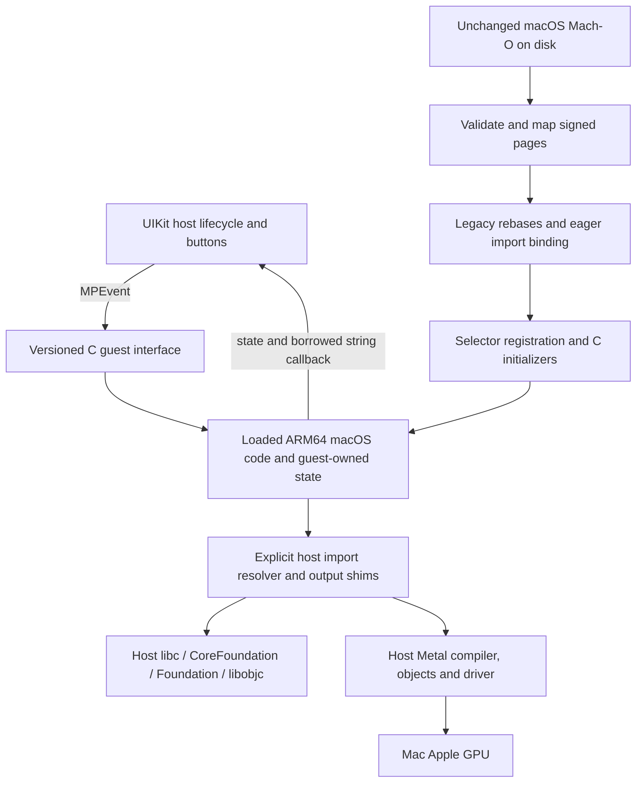

# Phase 2 report

1 October 2026 · `/Users/<user>/machprobe`

## Outcome

**VERIFIED:** a UIKit/Catalyst host now runs an interactive, unchanged-after-build ARM64 macOS guest through our runtime. Increment, Decrement and Reset reach guest code; the guest owns the state and sends the result back through a callback. The original four Phase 1 binaries also run unchanged through this runtime. CoreFoundation, Foundation/Objective-C and a deterministic Metal compute experiment work on this Mac.

**No iOS compatibility is claimed.** All runtime execution was on macOS or its Catalyst infrastructure. The user-selected vphone-cli research direction is documented and a conventional iOS project is prepared; Phase 3 has not started.

## Architecture actually implemented



`runtime/image.c` owns admission checks, mappings, entry/symbol lookup and cleanup. `fixups.c` handles only observed legacy relocation operations. `services.c` supplies the explicit import list, host framework path mapping, text callbacks, selector canonicalization and C initialization. `runtime.h` exposes image lifetime/diagnostics; `guest_abi.h` defines the versioned event/callback interface. This is a small research runtime, not a dyld clone, emulator, process sandbox or general macOS application loader.

## Results

| Controlled case | Observed result |
|---|---|
| Original Hello | Exact original greeting through captured guest `puts` |
| Interactive guest | Guest computes `0 → 1 → 2 → 1 → 0 → -1`; independent contexts, error cases and callbacks verified |
| Original File I/O | Accepts host directory, performs round trip, removes temporary file; invalid directory fails |
| Original CoreFoundation | CFString creation/length/release; length 11 |
| Foundation | Class lookup, selector dispatch, array/string behavior, ARC/pools and weak reference clearing |
| Original Metal device | Apple M2, registry ID 4294968552 in this run, unified memory yes; output visible in UIKit |
| Metal compute | All 16 results `7,10,…,52` checked by guest and independently by host; checksum 472 |

UIKit interaction was visibly checked, including Increment, Decrement and Reset. User clicks also changed the running counter; those are recorded as user input rather than attributed to automation. The UI remains a small outer host with an inner guest display and controls. No decorative guest behavior is substituted for execution.

The complete [compatibility matrix and labeled findings](phase2-findings.md) distinguish host-supplied behavior from runtime implementation. In particular, host Apple libraries implement Objective-C and Metal. Selector registration and path translation are runtime adaptations. Guest-defined classes/categories, guest TLS, exceptions and modern chained fixups remain unsupported. A triangle and keyboard mapping were not required for the verified button/compute milestone and remain UNTESTED.

## Verification

All **30 Phase 1 inspector tests**, **8 Phase 1 loader tests**, and **10 Phase 2 integration tests** pass normally and with ASan/UBSan on the runtime/host harness. The Phase 2 ABI test contains assertions for integers, buffers, structs, callbacks, errors, variadics, per-thread errno, C initialization and 40 repeated load/state/destroy/unload cycles. It checks actual RX permissions, unmapped guest code after close, live-image counts and descriptor cleanup. Failed-open cycles and malformed/unsupported fixtures are also covered. Sanitizers instrument the runtime and host harness, not the untouched guest instructions, Apple frameworks or GPU execution; this is not a claim of universal memory safety.

The original guest files, Phase 1 sources/tests and evidence remain preserved. The new guests are macOS builds and retain their disk hashes through loading/packaging. Negative-test re-signed copies and the metadata-modified Catalyst **host** are recorded separately. No security protections were disabled.

Reproducible command/output records: [baseline](evidence/phase2/baseline.json), [results and tests](evidence/phase2/results.json), [UI build](evidence/phase2/ui-build.json), [UI observation](evidence/phase2/ui-observation.json).

## Build and run

From `/Users/<user>/machprobe`:

```sh
make all
make -f phase2/Makefile all
make -f phase2/Makefile test
make -f phase2/Makefile sanitize
build/phase2/runner build/framework
build/phase2/abi-test build/phase2/interactive
python3 phase2/host/build.py --launch
python3 phase2/capture.py
```

Close the Phase 2 app before rebuilding its bundle so mapped guest files are not replaced during use. Phase 1 commands remain unchanged. `phase2/capture.py` runs all existing/new suites and writes only Phase 2 evidence, preserving the original evidence records. The Phase 2 UI build deliberately retains Phase 1's minimal-declaration iOS-to-Catalyst approach because only Command Line Tools are available.

New layout: `runtime/` for the shared runtime/interface; `phase2/guests/` for three new controlled guests; `phase2/host/` for CLI/UIKit hosts and packaging; `phase2/tests/` for ABI/regression checks; `phase2/ios/` for the conventional SDK project; `docs/evidence/phase2/` for new evidence. Existing Phase 1 directories remain intact.

## Prepared next step and remaining gates

Read [the vphone-cli research](phase2-vphone-research.md) and [Phase 3 preparation](phase3-preparation.md). Upstream documents a patched/jailbreak iOS 27 pairing, debugserver-related support and paravirtual graphics. None has been tested locally. The user intends to supply that environment; a result there will be labeled **patched iOS VM**, not stock-device compatibility.

The prepared Xcode project/plists/scheme pass syntax checks, while the SDK preflight confirms missing full Xcode/iOS SDKs. No large tooling was installed. Executable admission/signing/memory policy, real iOS framework/helper availability and GPU behavior are still the first feasibility gates. No game, Steam client, Windows support or final launcher was built. Phase 2 stops here.
