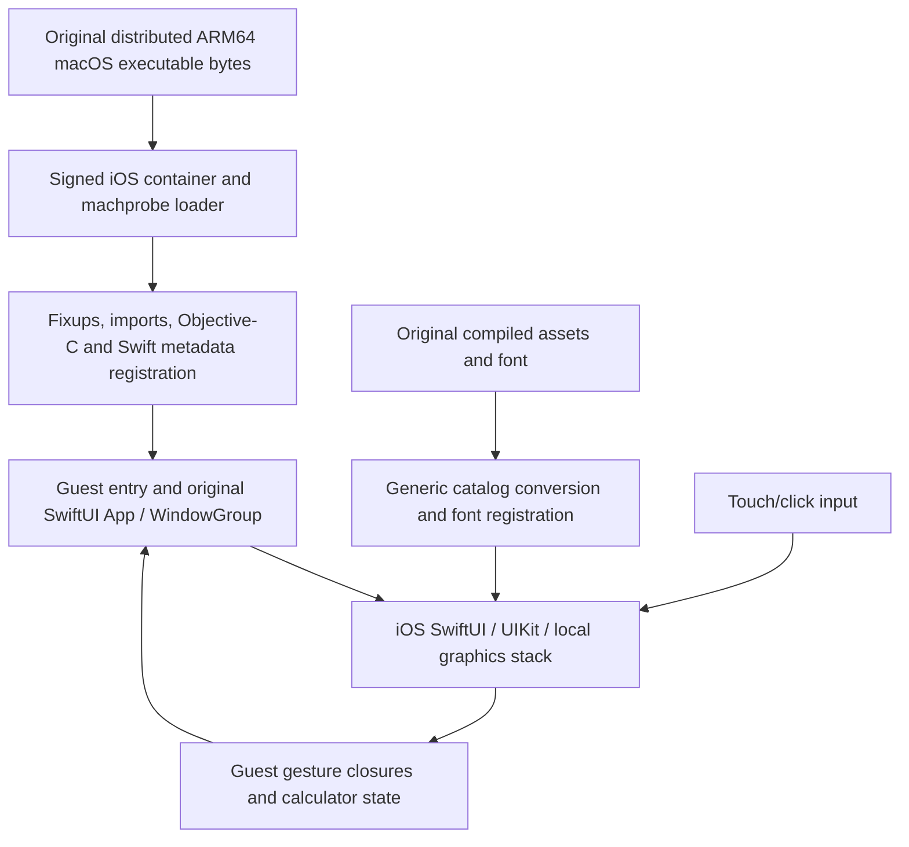

# Phase 4 findings — DashboardCalculator

1 October 2026. **VERIFIED** = observed tool/runtime/UI result; **DOCUMENTED** =
external implementation/documentation; **HYPOTHESIS** = interpretation;
**UNTESTED** = no execution proof.

**VERIFIED: the real distributed macOS ARM64 executable renders its own SwiftUI
calculator in the iOS VM and computes `2 + 2 = 4` and `7 × 8 = 56`.** No target
implementation source was read, copied, compiled or modified. No calculator was
recreated. This is a working research-VM milestone; independence from the VM's
custom signing/trust remains unproven.

## Preserved target

**VERIFIED:** Official release `v2.0-2203A1347`, published 20 January 2022,
marked prerelease by its author; newest asset in the queried release list.
Bundle version 2.0 / 2203A1347, ID `com.tom.DashboardCalculator`.
[Author's ZIP](https://github.com/elunico/DashboardCalculator/releases/download/v2.0-2203A1347/DashboardCalculator.app.zip).

| Object | SHA-256 |
|---|---|
| Downloaded ZIP | `1fb6534ee226be1d6b1d97c622b2482d5bda6658de773cdd9347a4abef8a433b` |
| Original universal executable | `a903615ed98f816b0e77a4e4150957659a23f6171db55c73d004da29d0a12517` |
| Exact ARM64 slice | `87986a2aaa6a000c6d72ad0ea46ae67683d7ce8d724a79e2ed1655077065299b` |

Original ZIP and app: `build/phase4/original/`. All eight bundle files are hashed
in [original-hashes.json](evidence/phase4/original-hashes.json). The separate
`build/phase4/selected-arm64` is exactly bytes 147456 through 267615 inclusive of
the universal executable. This is slice selection, **not the complete original
universal file**, and neither its bytes nor embedded signature were rewritten.
No target file was re-signed. Both complete executable and slice were independently
hash-verified inside the iOS diagnostic host.

**VERIFIED:** Apple `file`/`lipo` report x86_64 and arm64. Our inspector selects
ordinary arm64 subtype 0, MH_EXECUTE, macOS platform 1, minimum 11.0, SDK 12.1.
`LC_MAIN.entryoff = 11284`. `codesign --verify --deep --strict` passed and
`stapler validate` passed. Developer ID: Thomas Povinelli, team `9KTV75G5K9`;
hardened runtime, original app-sandbox and user-selected read-only entitlements.
This validates the preserved macOS package, not iOS admission or current
Gatekeeper policy under every network condition.

## Binary dependencies and lifecycle evidence

**VERIFIED:** One executable, no embedded frameworks/dylibs. Assets include
`Assets.car` and `DB LCD Temp-Black.ttf` in Resources and Resources/Fonts.
Info.plist requests Fonts via `ATSApplicationFontsPath`. The runtime registers the original font and supplies a converted iOS asset catalog;
actual asset loading and display were verified in the running guest.

The executable declares 22 libraries: Foundation, libobjc, libSystem, AppKit,
Combine, SwiftUI, and 16 Swift overlay/runtime install names. Twelve library
commands are weak loads; see the exact [otool list](evidence/phase4/otool-libraries.txt).
CoreFoundation, CoreGraphics, QuartzCore, Metal, Dispatch and other overlay names
are among these. A dependency declaration alone does not prove runtime use.
RPATHs are `/usr/lib/swift` and `@executable_path/../Frameworks`.
Our recursive dependency report records host shared-cache limitations; it is not
a claim that every transitive iOS dependency was enumerated.

**VERIFIED:** Legacy `LC_DYLD_INFO_ONLY`, not chained fixups. The weak-bind stream
is empty, but weak dylib load commands and weak symbol imports are present.
There are 194 undefined symbols: 179 strong and 15 weak.
One eight-byte `__objc_classlist` entry and Swift metadata sections occur:
`__swift5_entry`, `__swift5_typeref`, `__swift5_reflstr`, `__swift5_fieldmd`,
`__swift5_assocty`, `__swift5_capture`, `__swift5_proto`, `__swift5_types`.
No `S_MOD_INIT_FUNC_POINTERS` section was found. This does not mean initialization
is unnecessary: Objective-C/Swift metadata and the SwiftUI lifecycle still need it.

**VERIFIED binary imports:** SwiftUI `App.main`, `App`/`Scene`/`View` descriptors,
`WindowGroup`, state/observed-object facilities, text/image/layout types,
`onTapGesture`, `DragGesture`, and Combine observable-object machinery.
These identify the expected lifecycle and input APIs without reading app source.
App/WindowGroup startup and interactive redraw are now **VERIFIED**. General
macOS window management, focus rules and teardown remain **UNTESTED**.

## Failure-driven runtime changes

The initial diagnostic evidence is retained unchanged in `mac-probe.json` and
`ios-probe.json`; those files describe the old loader, not the final runtime.

| Observed failure | Implemented compatibility behavior | Status |
|---|---|---|
| Universal header rejected | Select the exact existing ARM64 byte range | VERIFIED |
| Compiled class metadata rejected | Opt-in class admission and explicit Objective-C/Swift metadata registration | VERIFIED |
| Additional dylibs, weak loads and legacy fixups | Bounded extended import policy, weak missing imports become null, required legacy opcodes | VERIFIED |
| Missing NSImage/NSSound and Swift overlay exports | Generic image, Swift Image constructor and sound adapters | VERIFIED for exercised paths; sound equivalence UNTESTED |
| Guest body asserts a required image is absent | Decode original compiled assets and compile an iOS resource catalog | VERIFIED |
| First input raises missing NSNumberFormatter selector | Map legacy thousand-separator property to host grouping-separator property | VERIFIED |

The final image applies 223 rebases and 244 binds. The guest's original `LC_MAIN`
runs after metadata registration. No app-name or calculator-button branches were
added to the runtime. The preparation/build tool names the selected input only.

The loader now supports `REBASE_ADD_ADDR_ULEB`, dylib ordinal ULEBs,
`BIND_DO_BIND_ADD_ADDR_ULEB`, and scaled immediate bind increments. Existing bounds,
writable-pointer checks and limits remain. Weak imports are opt-in; unresolved
strong imports still fail. A nonempty weak-coalescing stream remains unsupported.
RPATH records are validated, but this target's absolute install names are resolved
against allowed host libraries; generic @rpath search is not implemented.

## Swift, Objective-C and lifetime

**VERIFIED:** the host supplies Swift allocation, retain/release, type lookup,
witness tables, Objective-C bridging, Foundation, Combine, and the common SwiftUI
facilities exercised by this app. The guest's compiled class is registered with
`objc_readClassPair`; Swift protocol, conformance and type-record ranges are
registered through `swift_registerProtocols`, `swift_registerProtocolConformances`
and `swift_registerTypeMetadataRecords` as present. This enabled the actual
compiled guest UI and state logic, beyond merely resolving symbol names.

**DOCUMENTED:** these registration hooks are implementation/SPIs, not a promised
cross-platform public API. References consulted were the platform runtimes, never
the calculator implementation:
[Apple Objective-C runtime](https://github.com/apple-oss-distributions/objc4/blob/main/runtime/objc-runtime-new.mm),
[Swift Objective-C interoperability](https://github.com/swiftlang/swift/blob/main/docs/ObjCInterop.md),
[Swift metadata lookup](https://github.com/swiftlang/swift/blob/main/stdlib/public/runtime/MetadataLookup.cpp),
[Swift protocol conformance](https://github.com/swiftlang/swift/blob/main/stdlib/public/runtime/ProtocolConformance.cpp).

Published metadata keeps guest mappings and host dylib handles pinned for process
lifetime. Closing a pinned image intentionally does not unmap it. Launch one such
guest per process. The extension resolver/cache is configured before loading and
used serially. There is no general metadata-unregistration implementation.
The loader is not an isolation boundary for hostile native code.

This target has no C initializer-pointer section. General images requiring metadata
registration before C initializers, categories, nonlazy classes, arbitrary reflection,
async/concurrency and unload/reload are **UNTESTED or unsupported**, not implied by
this successful app. Default Phase 1–3 loading policy still rejects compiled class
metadata unless the extension is explicitly enabled.

## SwiftUI, resources, rendering and input

**VERIFIED:** our launcher does not start a competing UIKit application lifecycle.
It invokes the original entry, whose SwiftUI App/WindowGroup machinery starts the
host iOS UI. The guest creates its own view tree and closures. The iOS SwiftUI,
UIKit and graphics stack render that tree locally in the VM.

Our NSImage compatibility object holds a UIImage. A Swift-compiled ABI adapter
implements the missing SwiftUI Image(nsImage:) entry using Image(uiImage:).
This is a real constructor adapter, not a class-pointer alias. NSNumberFormatter's
legacy `setHasThousandSeparators:` maps to `usesGroupingSeparator` on a subclass.
NSSound's beep maps to an iOS system sound; exact audible equivalence is untested.

The resource converter reads the original compiled `Assets.car` through macOS
resource APIs, exports original pixels/colors with their names, appearance and
scale, then uses Apple's actool for the iOS catalog. It does not execute the target
on macOS, capture rendered frames, draw controls or recreate layouts. Original
font bytes are copied. **The generated package's resource format is adapted;
the original app and guest executable bytes remain unchanged.** No claim is made
that arbitrary asset catalogs or appearance variants are universally supported.

**VERIFIED UI observation:** clear, 2, +, 2, = displays 4; clear, 7, ×, 8, = displays
56. These are observed interactions, not an automated semantic accessibility test.
[Saved screen showing 4](evidence/phase4/calculation-2-plus-2.jpg) and
[interaction record](evidence/phase4/interactions.json). The original calculator
assets/buttons and display are recognizable. Pointer motion, keyboard input,
all memory/decimal operations, focus, resizing, multiple windows and complete
AppKit semantics remain **UNTESTED**. The app's fixed-size layout appears centered
in the iOS scene; no polished launcher or layout replacement was added.

## Integrity and packaging

**VERIFIED:** the original slice is embedded contiguously in RX/RW guest sections
of a separately signed iOS dylib. The container grants executable admission to
those bytes; our loader relocates writable data and supplies imports. Normal
relocations change live data pointers, not the saved executable or instructions.
The host hashes the complete resident guest before fixups and records the original
slice hash. The selected macOS platform metadata and embedded signature remain
inside the preserved bytes; we do not ask dyld to load that macOS executable as
an ordinary iOS Mach-O. This is build-time packaging, not arbitrary download-and-run.

[Runtime record](evidence/phase4/runtime-success.json) records PID 768, run
`BCBFFC6A-580F-49A4-AEFC-0B7748AF7D82`, original SHA-256, and fixup counts.
`stage: guest entry` is expected while the guest-owned application event loop runs;
that marker alone is not evidence of rendering. The interaction observations
supply that evidence. Package and original-bundle tests verify exact byte equality.

## Security and remaining host dependencies

**VERIFIED:** execution was in the existing iOS 27 vphone VM, firmware 24A435,
Launchpad/Bundle 2.2.5, without attaching a debugger for the successful run.
Our build requests no private entitlements. However the VM installer adds
`jb.pmap_cs_custom_trust = PMAP_CS_APP_STORE` and
`com.apple.private.security.container-required`; see
[installed app record](evidence/phase4/runtime-installed.json). Earlier observations
also show SystemHook-vphone and libcamfix loaded by this environment.
No security settings, trust policy or bootstrap were changed for Phase 4.

**UNTESTED:** ordinary iOS development signing, sandbox/signing independence from
VM modifications, and physical iPhone execution. Under the original strict
normal-sandbox acceptance condition, that part of Phase 4 remains unverified;
the working research-VM result must not be substituted for it.

Runtime dependencies supplied by iOS include Swift, Objective-C, Foundation,
Combine, SwiftUI, UIKit, CoreText, AudioToolbox and the graphics stack. macOS is
used at build time for Xcode, signing and original asset extraction, not for
runtime rendering. SwiftUI rendering does not establish our own general Metal
translation layer; Phase 3 controlled Metal results remain separate evidence.

**HYPOTHESIS:** these bounded adapters and registration mechanisms will help other
similar binaries. No general macOS/SwiftUI compatibility claim follows from one
app. No Phase 4.5 or game work has begun.
