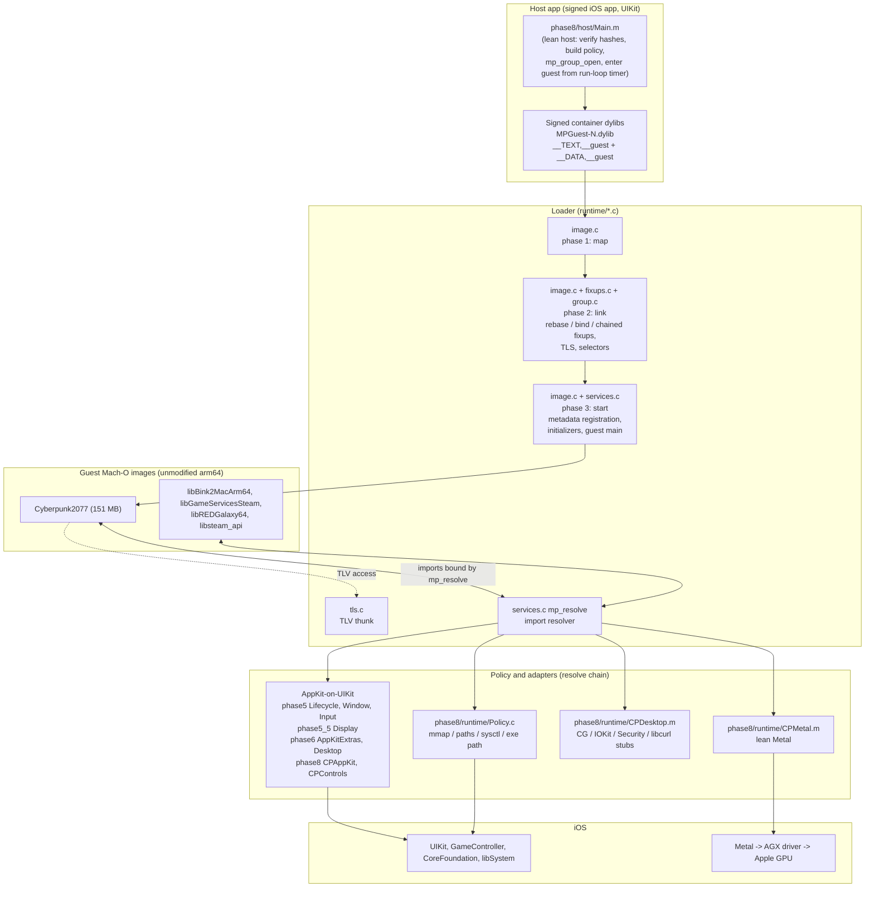

# 02 - Architecture

> Not piracy: no game files are included; you need your own copy. MIT-licensed. See [../NOTICE.md](../NOTICE.md).

This section documents the machprobe code: what each layer does, the key
functions, how the layers fit together, and why they are shaped the way they
are (including which bug forced a design). All paths are relative to the
repository root. Per-game history lives in
[../03-phase-history/](../03-phase-history/), the Cyberpunk 2077 specifics in
[../04-cyberpunk/](../04-cyberpunk/), and the diagnostics and device tooling in
[../05-tools-and-diagnostics/](../05-tools-and-diagnostics/).

## What machprobe is, in one paragraph

A translation layer that runs **unmodified macOS arm64 apps on iOS**. No JIT and
no instruction translation: the game code is already arm64. The layer (1) loads
the game's Mach-O images itself, (2) answers the game's imports with iOS
equivalents (AppKit on UIKit, CoreGraphics/IOKit/Carbon stubs, filesystem and
memory policy), and (3) passes Metal straight through to the real GPU. Game
bytes are never modified; every image is SHA-256 verified at launch.

## Files in this section

| File | Covers |
|---|---|
| [loader.md](loader.md) | `runtime/`: map, link, start; chained fixups; export trie; initializers; ObjC registration; signed containers; import interposition and policy |
| [tls.md](tls.md) | `runtime/tls.c`: thread-local variables, the dyld-style fast path, slow path, teardown order |
| [address-space-and-memory.md](address-space-and-memory.md) | iOS VA window, top-down rationing in `guest_mmap`, jetsam limit, the `hw.memsize` answer, Metal heap caps and spill-over |
| [appkit-on-uikit.md](appkit-on-uikit.md) | `phase5/runtime`, `phase5_5/runtime/Display.m`, `phase6/runtime`, `phase8/runtime/CPAppKit.m`: NSApplication/NSWindow/NSEvent emulation, event queue, key-window fallback, coordinates, display modes |
| [metal.md](metal.md) | `phase8/runtime/CPMetal.m` and the earlier `phase5`/`phase5_5` Metal adapters: pass-through, Mac-only additions, Managed to Shared |
| [system-services.md](system-services.md) | Case-insensitive paths, HOME remapping, sysctl, offline libcurl, CoreGraphics/IOKit/Security stubs (`phase8/runtime/CPDesktop.m`, `phase6/runtime/Desktop.m`) |

## Big picture



The same picture as a plain call stack (top = what the game thinks it is
talking to, bottom = what actually runs):

```
 Cyberpunk2077 + 4 dylibs   (macOS arm64 code, executes natively on the iPhone CPU)
        |  every import (mmap, fopen, NSWindow, MTLDevice, curl_*, ...)
        v
 mp_resolve()  ----> policy chain:  phase8 Policy.c -> phase8/6/5.5/5 adapters -> host dlsym
        |                              |                    |                         |
        |                              v                    v                         v
        |                       mmap/path/sysctl      AppKit-on-UIKit            real iOS symbol
        |                       interposers           (MPGameWindow, ...)         (libSystem, ObjC)
        v
 Metal calls go to Apple's real MTLDevice (CPMetal.m only adds Mac-only methods
 and rewrites Managed storage to Shared), i.e. the AGX driver and the GPU.
```

## Layer-by-layer summary

1. **Host app.** A normal signed iOS app. `phase8/host/Main.m` verifies each
   embedded guest image against `target.json` hashes, creates the virtual
   executable path, applies `Documents/env.json` (`MP_*` tuning variables),
   calls `mp_group_open`, and starts UIKit first. The guest's `main` is entered
   later from a run-loop timer (see [appkit-on-uikit.md](appkit-on-uikit.md)).
2. **Loader (`runtime/`).** Three phases, map, link, start. It is a Mach-O
   dyld subset: legacy rebase/bind opcodes, chained fixups
   (`DYLD_CHAINED_PTR_64_OFFSET`), export trie, `__init_offsets`, TLS,
   Objective-C selector fixup. See [loader.md](loader.md), [tls.md](tls.md).
3. **Guest images.** Run unchanged. Code pages are file-backed pages of a
   signed container dylib that iOS itself loaded; the loader never makes
   writable pages executable.
4. **Policy and adapters.** The loader binds imports through a policy chain
   (`MPExtensions.resolve`). The chain intercepts memory, filesystem and sysctl
   calls ([address-space-and-memory.md](address-space-and-memory.md),
   [system-services.md](system-services.md)), substitutes AppKit with UIKit-backed
   stand-in classes ([appkit-on-uikit.md](appkit-on-uikit.md)), and hands out
   Apple's real Metal device ([metal.md](metal.md)).
5. **Metal and AGX.** Pass-through. Per the project's settled facts, layer
   overhead is about 1-5 percent; frame rate on the iPhone 18 Pro is limited by
   the GPU and heat, not by the layer (`CONTEXT.md`, "Facts settled in
   conversation").

## Source tree map

| Directory | Role |
|---|---|
| `runtime/` | The loader: `image.c`, `fixups.c`, `group.c`, `services.c`, `tls.c`, `internal.h`, `runtime.h` (public API), `guest_abi.h` |
| `phase4/runtime/Extended.c` | Base policy (`mp_extended_policy`), ObjC class/category/Swift metadata registration (`mp_register_metadata`) |
| `phase5/runtime/` | AppKit stand-ins: `Lifecycle.m`, `Window.m`, `Input.m`, `Menu.m`, `Controls.m`, `AppKitCompat.m` (symbol map), `MetalCompat.m` |
| `phase5_5/runtime/` | Large-game policy, `Display.m` (CoreGraphics display model), `Keyboard.m` (Carbon), `LazyImports.c`, Legacy Metal proxies, `BaseVertex.m` |
| `phase6/runtime/` | SDL/SuperTuxKart adapters: `AppKitExtras.m`, `Desktop.m`, `GameControls.m`, `Watchdog.m`, `Survey.m`, STK `Policy.c` |
| `phase8/runtime/` | Cyberpunk: `Policy.c`, `CPAppKit.m`, `CPControls.m`, `CPDesktop.m`, `CPMetal.m` |
| `phase8/host/Main.m` | Lean iOS host for Cyberpunk |

Policies stack: `mp_extended_policy` (phase4) < `game_policy` (phase5) <
`mp_large_game_policy` (phase5_5) < `mp_stk_policy` (phase6) or `mp_cp_policy`
(phase8). Each layer copies the one below and overrides `library_allowed`,
`resolve`, and a few flags. This is why later games needed only small
per-game files.

## Cross-cutting design principles

- **Admission is not implementation.** Allowing a library path
  (`library_allowed`) never manufactures its symbols; unresolved imports fail
  or abort with the symbol name. The adapters answer honestly (an error code
  when iOS cannot do the thing) rather than inventing success.
- **Adapters are driven by evidence.** Import probes (`phase8/tools/import_gaps.py`,
  the loader's `unresolved` callback) and selector surveys
  (`phase6/runtime/Survey.m`, `MP_SEL_SURVEY`) list what a game actually needs;
  the layer implements those. See
  [../05-tools-and-diagnostics/](../05-tools-and-diagnostics/).
- **Hot paths stay thin.** After profiling showed the game was GPU-bound,
  per-call work in the layer was removed (TLS fast path, lock-free selector
  dedupe, `useHeap:` hooks free until a heap spills; commit `25bef28`).
- **Own copies only.** The layer targets the user's own retail copies; see
  [../06-policies-and-roadmap/](../06-policies-and-roadmap/).

Where `CONTEXT.md` and the code disagree (for example the `hw.memsize` value,
the heap cap, and the spill margin changed during Phase 8), these docs follow
the code and note the history.
