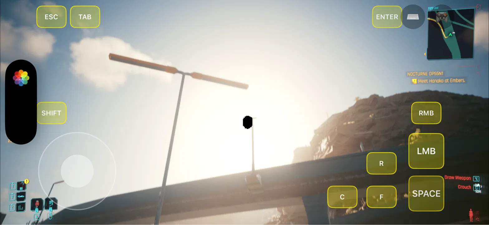

# Known issues, planned next steps, and documentation drift

State as of 12 Oct 2026. Items are ordered by how much they
affect play. The plan order follows the "Plan agreed 10 Oct 2026" section of
`CONTEXT.md`, with the memory and performance items added where the notes name them.

## Open problems

### 1. Memory creep and kills

- `malloc-small` (VM tag 2) grows about 1.4 MB/s during play. A car crash at about
  265 MB free was killed by iOS (9 Oct notes, CONTEXT). The spill-over cap
  (`MP_SPILL_CAP_MB`, default 1024) limits GPU growth only, not this creep.
- Cause not found. Hypotheses and the test plan are in `memory.md`.
- Related: engine allocator regions grow about 1.2 GB on world load. Finding RED's
  streaming budgets is still open (CONTEXT, "CPU side").

### 2. Frame pacing and the 60 fps ceiling

- Calm scenes run at a locked 60 fps with VSync 120 and MaximumFPS 60. Something still
  holds presentation at 60 even with a 120 Hz panel.
- Candidates: `CAMetalDisplayLink` `preferredFrameRateRange` (not present in the
  repository); `CADisableMinimumFrameDurationOnPhone` is set in `phase8/tools/build.py`
  but its effect is unverified.
- Target from the plan: 120 Hz in menus, 60 fps cap in gameplay, optional 40 fps
  "cool" mode.

### 3. Heat

- The iPhone 18 Pro (not Max) throttles within minutes at uncapped frame rates.
  The thermal state is logged in `[perf]` (`0cb6e9e`), but no long-session thermal
  log is recorded in the repository yet.
- The user's current practice: play unplugged, with a cooler, at a frame cap.

### 4. GPU-bound rendering

- Main thread about 1 %; GPU busy in the city. Minimum settings barely help.
- The `gpu_busy` telemetry sums overlapping command buffers and overstates busy
  time (CONTEXT). Merge intervals before trusting it.
- Managed-to-Private render-target experiment is built (`MP_MANAGED_RT_PRIVATE`)
  but not yet run on the phone.
- The build from `0cb6e9e` (thermal, census, spill cap) is on the phone: it was included in the
  icon reinstall (`ed2227a`) and in the install under the new App ID (`5e022eb`, 10 Oct 2026).

### 5. Touch controls

- The current pad is a quick version the user dislikes. Rebuild planned (see
  `input-and-controls.md`): floating analog stick, bigger buttons, look sensitivity
  setting.
- Look sensitivity is a constant (2.2) with no UI.

### 6. Provisioning profile expiry

- The development profile for `research.machprobe.CP2077` expires 17 Oct 2026
  (CONTEXT). Today is 12 Oct, so this is five days away.
- Refresh with the signing project in `phase7/signing` (build with the App ID
  override; the link error is expected, only the profile matters). Then
  `phase8/tools/phone.py deploy` picks the newest profile for the App ID.
- Re-signing and installing over the existing app keeps the game data and saves.
  Never delete the app: that loses the 60 GB copy.
- Free account limit: 10 App IDs a week. Do not create a new App ID without asking.

### 7. Steam sign-in and download (planned, not started)

- Plan (CONTEXT item 4): sign in to Steam by QR code, list owned games, and download
  the macOS depot of app 1091500 from Valve's CDN, resumable (about 60 GB over Wi-Fi).
- Repository state: no code for this in `phase8/`. The only related pieces are the
  copy tooling (`phase8/tools/push_resume.py`) and the phone-tool (`phone.py push-data`).
- Policy note from CONTEXT: sideload-only, the user's own copy, and Valve's terms
  are a grey area for this use. Get the user's explicit go-ahead before starting.

### 8. Unverified runtime pieces

- Steam API on the device: `libsteam_api` and `libGameServicesSteam` load in the
  Mac build; their behaviour on the phone is not recorded.
- Instruments: `xctrace` showed the phone as offline on 9 Oct. A Metal System Trace
  is still needed.
- Bug 29 in `bug-log.md`: a worker-thread crash at guest+0x1788e4c during menu load
  (9 Oct evening). No resolution recorded. Not seen again in later notes.

### 9. Controllers

- Xbox-style pad confirmed. MFi and PlayStation pads are expected to work through the
  same framework but are not recorded as tested. Bluetooth keyboards are not
  recorded as tested either.

### 10. Black blob near the sun while the camera moves (bug #30)

*Screenshot from the iPhone 18 Pro, 12 Oct 2026: the black blob just below the sun.*

- **Symptom:** a hard-edged black blob appears in the sky next to the sun, only while the camera
  is moving (controller or touch). It stays at the same place in the sky, flickers off for a
  moment during movement, and vanishes when the camera stops.
- **Not seen on the Mac** by the project owner when playing the same game there.
- **Fix: turn Motion Blur off.** Settings → Graphics → **Motion Blur → Off** removes the blob
  completely. The recommended settings file (`phase8/config-recommended-UserSettings.json`) now
  ships with Motion Blur **Off**, so `setup.py restore` gives new installs the fix automatically.
  The open question is only *why* it happens with motion blur on (below).
- **Ruled out:** spill-over heaps missing from the game's residency sets (fixed anyway in
  `b71df49`; the log confirms the fix is active and the blob remains); Managed→Shared texture
  storage (all textures are Private); GPU-name quirk tables (none in the game binary).
- **Leading theory:** the sun's HDR value overflows to infinity in the scene-colour buffer, and
  motion blur's weighted average turns it into NaN (∞ × 0), which displays as black. The
  recommended settings use *Color Precision: Medium* (a compact HDR format with less headroom);
  the test is Color Precision → High with motion blur on.
- **Next step if that doesn't fix it:** a Metal GPU frame capture of a frame showing the blob,
  then inspect the motion-blur pass next to the sun.
- Details: [bug-log.md](bug-log.md), row 30.

## Planned next steps (in the order agreed on 10 Oct)

1. Touch controls rebuild (`CPControls.m`).
2. Frame pacing and heat: 120 Hz menus, 60 fps gameplay cap, optional 40 fps mode.
   Find what still caps at 60.
3. Resolution sweep on the same drive: 1310x603, 1564x720, 1748x804, 1956x900,
   2348x1080, native. Measure fps, thermal state and memory for each. Pick defaults
   from the data.
4. In-app Steam sign-in and download (multi-session; see item 7 above).
5. Dynamic GPU memory governor: grow when free memory allows, freeze on pressure and
   on iOS memory warnings (CONTEXT plan; not yet in the repository).
6. Find the malloc-small creep, checking the layer's own paths first.
7. Texture storage experiment (Private where the CPU never touches the resource).
8. Instruments trace once the phone shows as online.

## Documentation drift found while writing this folder

These are places where `CONTEXT.md` and the code (or commit messages) disagree.
The code is taken as the truth in this folder, and the number is noted.

| Topic | CONTEXT.md or a commit says | The code says | Where |
|-------|------------------------------|---------------|-------|
| Heap cap | 512 MB (`MP_HEAP_CAP_MB`, CONTEXT 9 Oct) | Default 96 MB (`cap=... : 96`) | `phase8/runtime/CPMetal.m`, commit `04c412a` |
| `hw.memsize` report | 8 GB (CONTEXT; commit `538ebc6`) | Default 3 GB | `phase8/runtime/Policy.c`, `phase8/runtime/CPDesktop.m`, commit `04c412a` |
| Spill-over margin | 600 MB (commit `538ebc6`) | `marginBytes` = 900 MB | `phase8/runtime/CPMetal.m` |
| Look area | "right half" (`CPControls.m` header comment) | Right 55 % (`x` from 0.45 x width) | `phase8/runtime/CPControls.m` |

Other notes:
- The settings file (`phase8/config-recommended-UserSettings.json`) matches the values
  in CONTEXT (1564x720, VSync 120, MaximumFPS 60, Low texture quality, and so on).
  The DRS block still carries the old values (target 30 fps, 50-65 % range) with
  `DynamicResolutionScaling` False.
